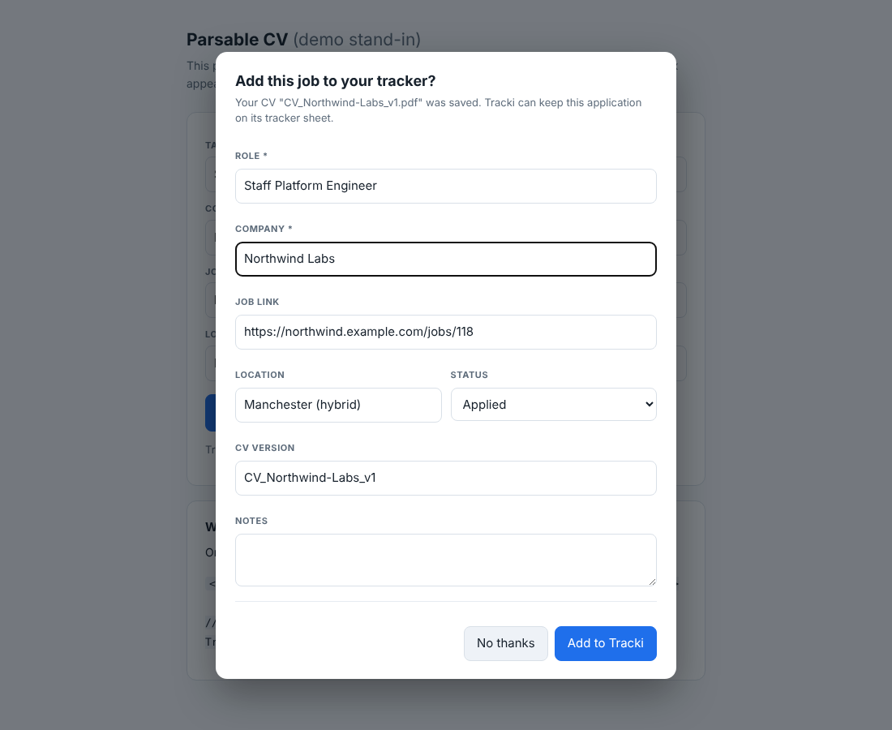
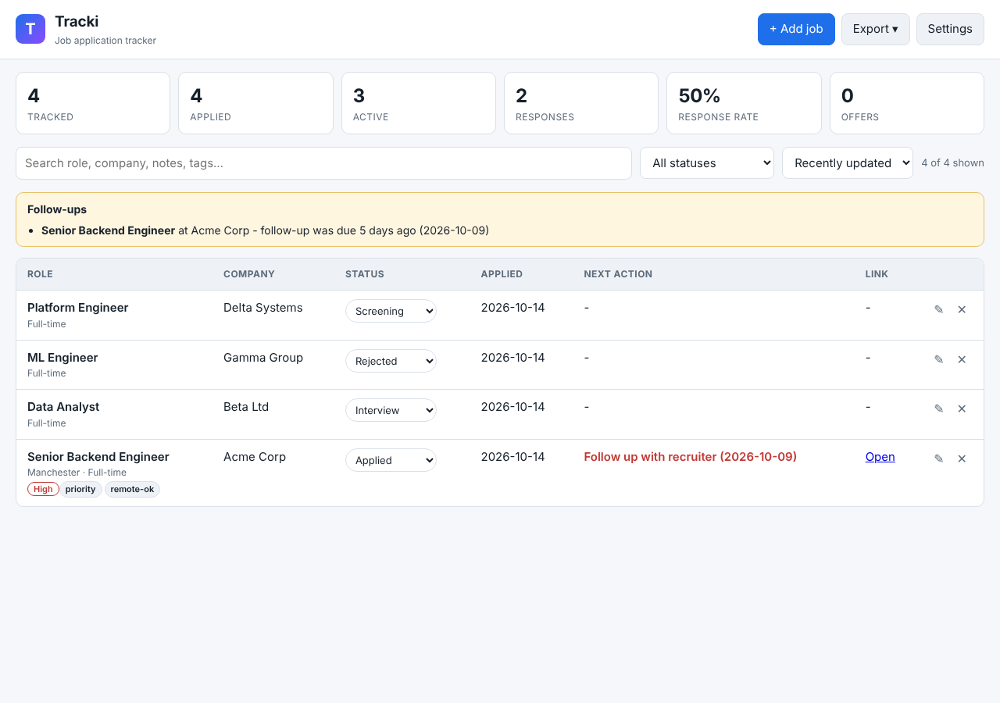
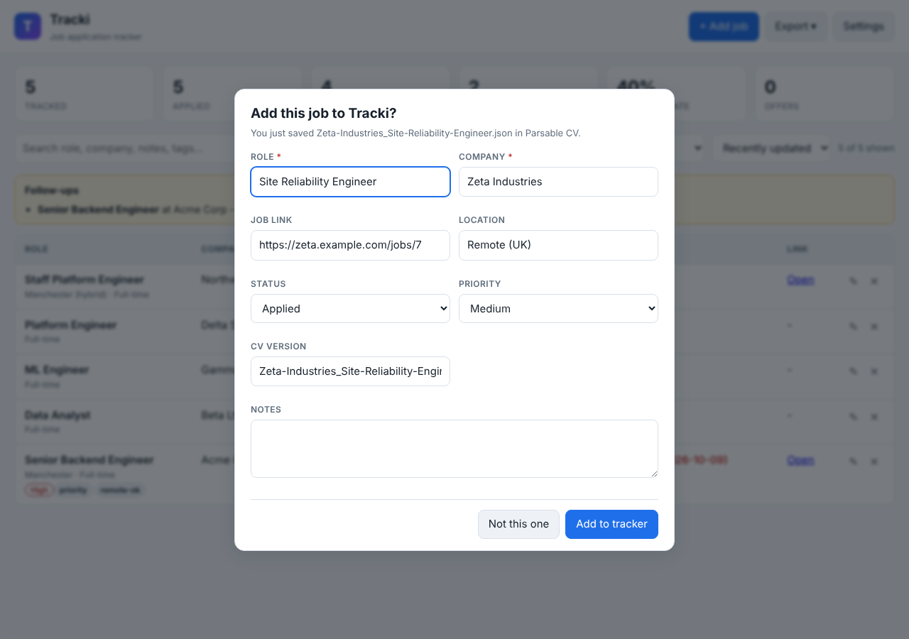
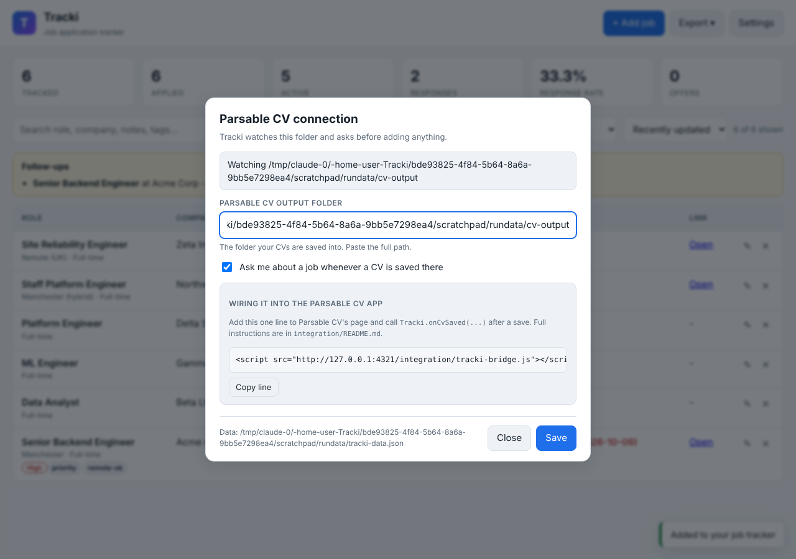

# Tracki

A local-first job application tracker that hooks into your **Parsable CV** app:
save a CV there, and Tracki asks — in a dialogue box — whether to add that job to
your tracker sheet. The sheet exports to Excel whenever you want it.

Everything runs on your own machine. No account, no cloud, no telemetry; your
tracker is a single JSON file you can copy, back up or move.

```
+-----------------+   you save a CV    +---------------------+   yes    +----------------+
|  Parsable CV    | -----------------> |  "Add this job to   | -------> |  Tracki sheet  |
|  (your app)     |                    |   your tracker?"    |          |  -> Excel      |
+-----------------+                    +---------------------+          +----------------+
```

## What it looks like

The dialogue box, raised inside the Parsable CV window the moment a CV is saved.
Every field is pre-filled where Tracki could work it out, and editable before you
commit to it:



The tracker itself: pipeline status on every row, overdue follow-ups called out at
the top, and the dashboard across the header.



When Tracki is watching the CV folder instead, the same question is asked in the
Tracki window, with the role, company and link read out of the saved CV:



## Requirements

Node.js 18 or newer. Nothing else — Tracki has **zero npm dependencies**, including
the Excel export, so there is no `npm install` step and nothing to keep updated.

## Start it

```bash
cd Tracki
npm start
```

On Windows you can just double-click **`start-tracki.bat`**.

Tracki opens at <http://127.0.0.1:4321> (it listens on localhost only, so nothing
on your network can reach it).

## Connect it to Parsable CV

Parsable CV lives on your PC, at something like
`D:\claude code repo\Parsable CV`. There are two ways to connect it, and they
work together — use either or both.

### 1. Watch the output folder (no code changes)

Open **Settings** in Tracki, paste the folder Parsable CV saves finished CVs into,
and save. From then on, whenever a CV file appears there, the Tracki window raises
the "Add this job to Tracki?" dialogue with the role, company and job link already
filled in where it could work them out (from the CV's JSON, its text, a sidecar
`.json`, or failing that the filename).



### 2. Ask inside Parsable CV itself (one line of code)

If Parsable CV has a web UI, add this to its page:

```html
<script src="http://127.0.0.1:4321/integration/tracki-bridge.js"></script>
```

and call this right after it finishes saving a CV:

```js
Tracki.onCvSaved({
  role:    'Senior Backend Engineer',
  company: 'Acme Corp',
  jobUrl:  'https://acme.com/jobs/42',
  cvFilePath: 'D:\\claude code repo\\Parsable CV\\output\\CV_Acme_v3.pdf',
});
```

The dialogue box then appears **in the Parsable CV window**, right where you are.
Every field is optional and editable in the dialogue, so it is still useful when
your app only knows the filename.

If Parsable CV is Python or Electron rather than a web page, or you would rather
not touch its code at all, see **[integration/README.md](integration/README.md)** —
it covers every case, including a `Tracki.autoHook()` that needs no save-code changes.

**Try it first:** with Tracki running, open
<http://127.0.0.1:4321/integration/demo-parsable-cv.html>. That page stands in for
Parsable CV so you can see the dialogue before wiring up the real app.

## What the tracker holds

The usual job-tracker columns, and a few that earn their place:

| | |
|---|---|
| **Job** | Role, company, job link, location, work mode, employment type |
| **Pipeline** | Status (Wishlist → Applied → Screening → Interview → Take-home → Final round → Offer → Accepted / Rejected / Withdrawn / No response), priority, source |
| **Compensation** | Salary min, max, currency |
| **Dates** | Saved, applied, deadline |
| **Follow-up** | Next action and its date — overdue ones are flagged at the top of the window |
| **Contacts** | Contact name, email, referral |
| **Documents** | CV version and the CV file used (filled in by Parsable CV), cover letter sent |
| **Notes** | Free text and tags |

Plus an automatic history of every status change, and a dashboard: total, applied,
active, responses, response rate, offers.

## Export to Excel

**Export → Excel workbook (.xlsx)** gives you a real `.xlsx` with three sheets:

- **Job Tracker** — every job, every column, frozen header, auto-filter on, real
  date cells, numeric salaries, and clickable job links.
- **Summary** — the dashboard numbers and a count per status.
- **Activity log** — every status change with its timestamp.

`Export → Excel - current filter only` exports just what your search and filters
are showing. CSV and a JSON backup are in the same menu, and the JSON backup can
be imported again (duplicates are skipped).

## Your data

| | |
|---|---|
| Tracker file | `data/tracki-data.json` |
| Backups | `data/backups/` — the previous version is kept on every save, last 15 |
| Settings | `tracki.config.json` in this folder |

Writes go to a temporary file and are then renamed, so an interrupted save cannot
truncate your tracker. If the file is ever unreadable, Tracki copies it aside
rather than starting a fresh one on top of it.

To move Tracki to another machine, copy the folder — or just `data/tracki-data.json`.

## Settings

Set them in the Settings dialogue, or in `tracki.config.json`:

| Key | Default | Meaning |
|---|---|---|
| `port` | `4321` | Port Tracki listens on |
| `parsableCvPath` | `""` | Folder Parsable CV saves CVs into |
| `watchParsableCv` | `true` | Ask whenever a CV is saved there |
| `allowedOrigins` | `[]` | Extra origins allowed to call the API (localhost is always allowed) |
| `openBrowserOnStart` | `true` | Open the browser when Tracki starts |

Environment variables `TRACKI_PORT`, `TRACKI_DATA_DIR`, `TRACKI_CV_PATH`,
`TRACKI_CONFIG_FILE` and `TRACKI_NO_BROWSER` override the file.

## Tests

```bash
npm test
```

50 tests covering validation, storage, the Excel and CSV writers, CV parsing, and
the HTTP API end to end — including the folder watcher raising a real prompt.

## API

Useful if you want to script against it. All routes are under `/api`.

| | |
|---|---|
| `GET /api/jobs?q=&status=&sort=` | List and filter, with dashboard stats |
| `POST /api/jobs` | Create (409 if it looks like a duplicate; resend with `allowDuplicate`) |
| `PUT /api/jobs/:id` | Update (partial bodies are fine) |
| `POST /api/jobs/:id/status` | Move a job along the pipeline |
| `DELETE /api/jobs/:id` | Delete |
| `POST /api/intake` | Parsable CV tells Tracki a CV was saved — see the integration guide |
| `GET /api/pending` | Prompts waiting for an answer |
| `POST /api/pending/:id/accept` · `/dismiss` | Answer one |
| `GET /api/export.xlsx` · `.csv` · `.json` | Download (add `?scope=filtered` plus filters) |
| `POST /api/import` | Import a JSON backup |
| `GET /api/events` | Server-sent events, so open windows update live |

Only pages served from localhost (plus anything in `allowedOrigins`) may call the
API, so a random website you have open cannot write to your tracker.
